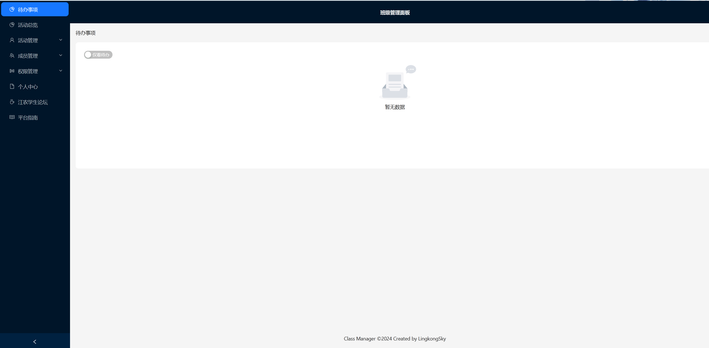
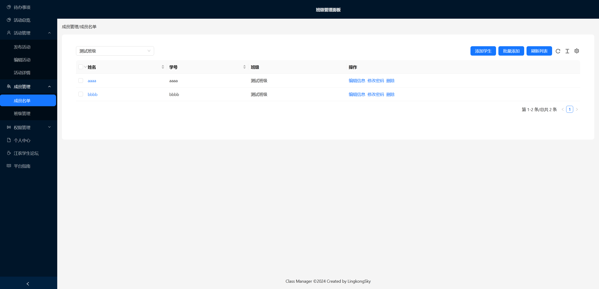
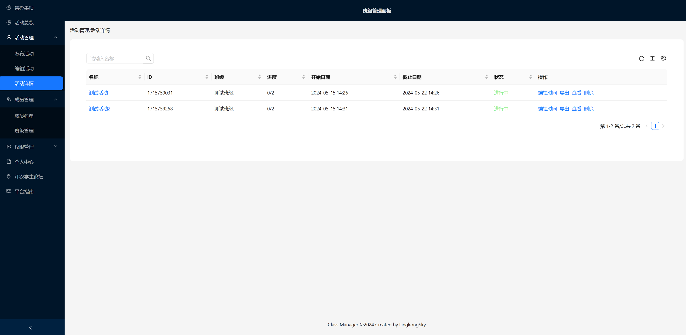
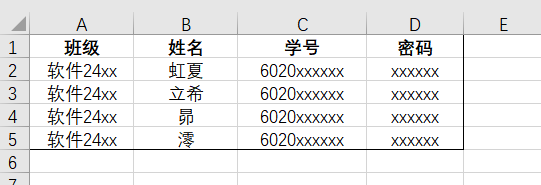
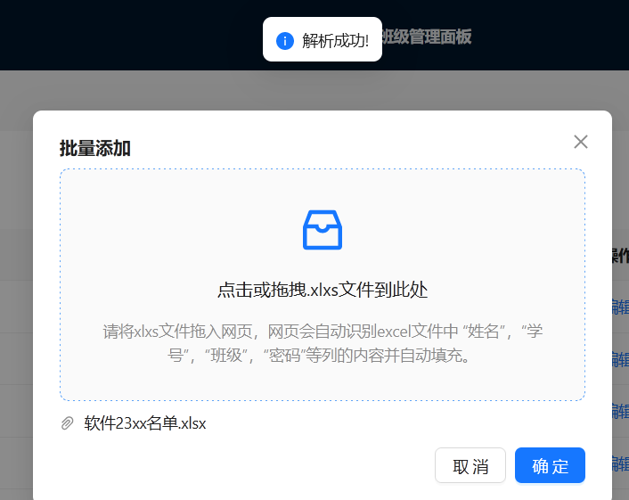
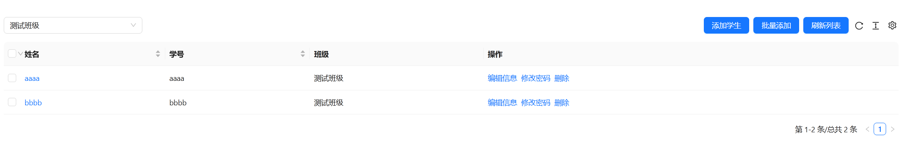

# 风线学生交互平台

首先，感谢您百忙之中抽空浏览该文档。

> 目前，项目正处于<code>内测阶段</code>，站内功能将对所有用户免费开放使用。

## 项目简介

本项目由在校生开发，旨在帮助学生们高效有序的管理班级，进行作业，活动的发布及收集。项目功能如下：       
- 通过Excel表格 [批量导入]()学生，管理员，权限组等信息。
- 发布作业支持文本，文件内容同时发布，同时可自定义接收类型
- 发布的作业及活动支持[二次编辑内容]()并修改收集时间
- 学生可[二次提交]()以覆盖之前的提交，也可下载之前提交过的作业文件
- 后台可查看详细的[提交情况]()，从具体学生到具体提交时间均作列表列出
- 支持作业收集自动打包导出，支持文件导出时的[自动重命名]()

## 例图

## 快速开始

 - ### 准备学生信息文件
    准备一份Excel表格，并确保其中含有班级，姓名，学号，密码四列

    

 - ### 开始导入

    进入成员管理-成员名单页面，并点击批量添加

    

    

 - ### 上传文件
    将编写好的Excel表格文件上传，显示解析成功即为格式正确，点击确定即可批量生成用户。

    

    

- ## [管理员指南](admin/ActivityCreate)

- ## [用户指南](student/Todos)

- ## [使用政策](other/TermsOfUse)

