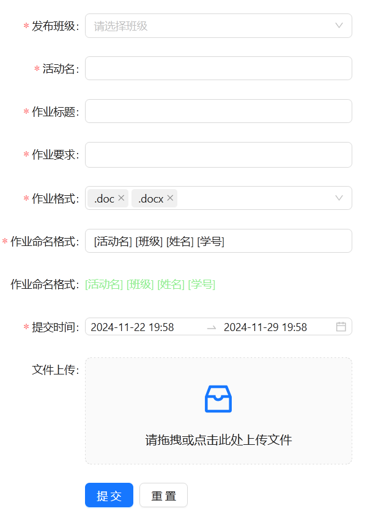

# 发布活动

## 表单填写
> 本页面用于管理员创建新活动。

#### 活动名
活动名称。用于供管理员查看的活动名称。

#### 作业标题
活动卡片上的粗体标题，用于展示给用户看的标题。

#### 发布班级
活动将发布至的目标班级。

#### 作业要求
可将有关作业的相关要求填写至此。

#### 作业格式
限制可接收的文件类型，支持同时允许多种类型。用户将只能上传符合类型的文件。

如添加<code>.zip</code> <code>.rar</code>，则用户只能上传后缀为<code>.zip</code> <code>.rar</code>的文件。

#### 作业命名格式
导出时的文件名格式，用于批量重命名。分为固定内容和可替换内容。

固定内容是每个文件名中固定会出现的部分，可替换内容则会根据用户的个人信息进行替换。
支持<code>[班级] [学号] [姓名] [活动名]</code>等可替换参数。

如：**实验1 [班级] [姓名]** -> **实验一 2023班 张三**

#### 提交时间
选择作业开始与截止时间，默认值为一周。

#### 文件上传
上传与活动一同发布的文件以供学生下载，可将实验模板，相关文件上传到这里。

