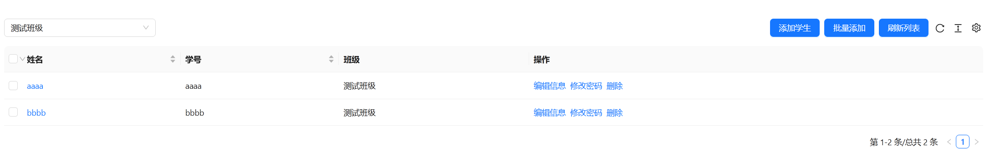
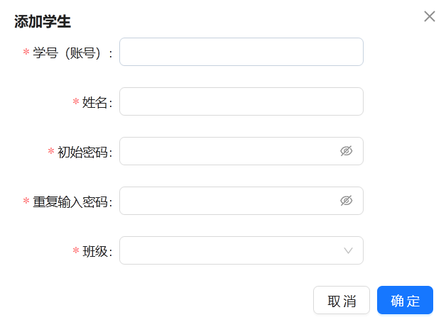
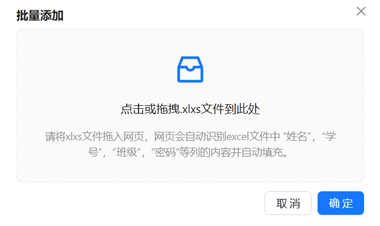
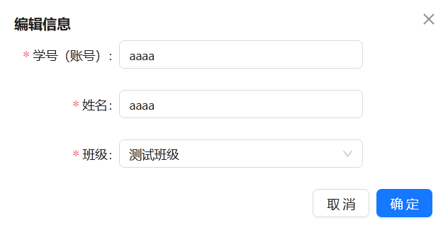
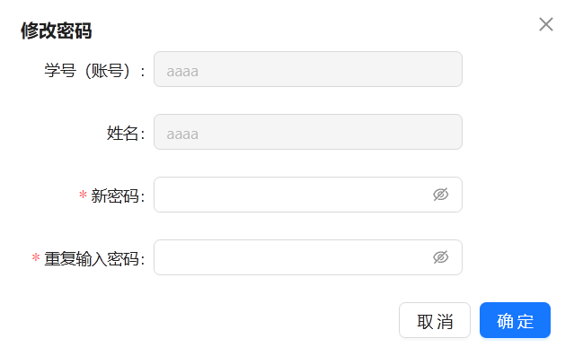
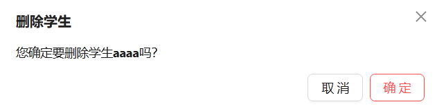

# 成员名单

## 添加学生
单击<code>添加学生</code>打开表单，输入学生信息后点击<code>确定</code>提交即可。

## 批量添加
确保xlxs表格中含有<code>姓名,学号,班级,密码</code>四列，将其上传到平台后，
平台会自动解析并根据表格内容进行添加。如果遇到解析失败，请检查表格是否有对应字段，
且是否无特殊字符及样式影响。（如账号重复，则会更新学生信息）

## 刷新列表
点击<code>刷新列表</code>按钮即可更新学生列表。

## 编辑信息
点击<code>编辑信息</code>后弹出学生信息表单，填写后再点击<code>确认</code>即可成功修改。

## 修改密码
点击<code>修改密码</code>后弹出修改密码表单，重复输入密码后再点击<code>确认</code>即可成功修改。

## 删除
在二次确认后删除该学生（不可恢复）

