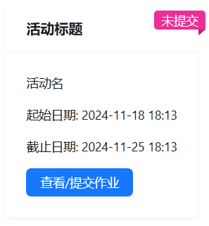
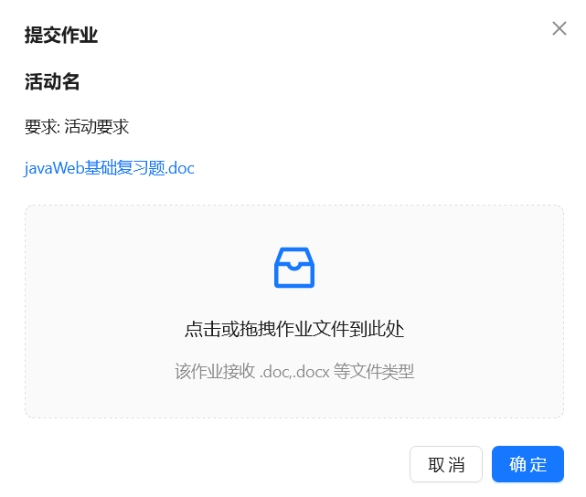

# 活动总览

## 查看/提交作业

### 查看作业

在未提交的活动卡片上，点击<code>查看/提交作业</code>将会弹出活动卡片，
活动卡片包括了活动标题，活动名，活动需求和活动文件四个部分。
用户可通过点击<code>蓝色字体</code>来下载文件。

### 提交作业

作业在发布时会被设置类型与大小限制，只有<code>符合文件类型</code>及<code>大小不超过上限</code>的文件才可正常提交。
文件无命名要求，上传后会根据规则自动重命名。

## 重新提交

对于已提交的活动，用户可以选择<code>重新提交</code>以覆盖之前提交的内容，平台只保留最新一次的提交记录。

## 下载作业

对于已提交的活动，用户可以通过<code>下载作业</code>来下载之前所提交的文件。平台默认保留最长五个月的文件记录。

* 注：对于已结束的活动不可再重新提交及查看，但是可以下载曾经提交过的文件。